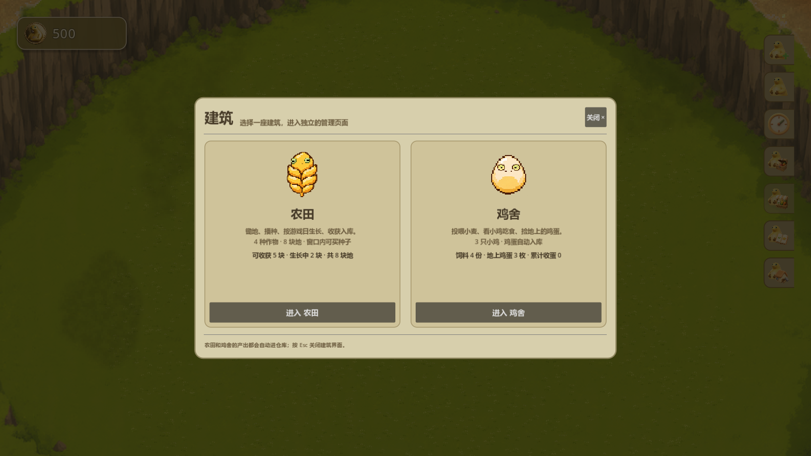
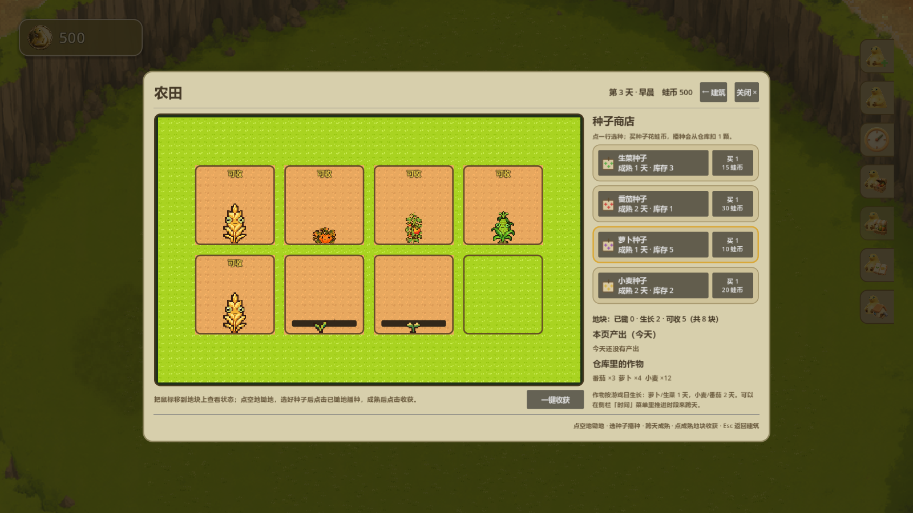
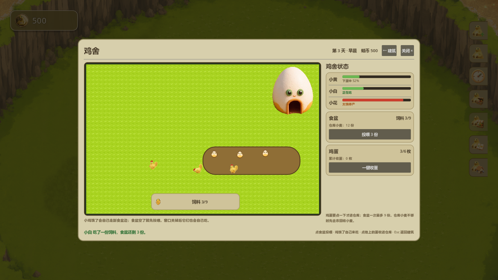

# 建筑系统：农田与鸡舍

> 版本：2026-11-15　分支：`feature/buildings`　引擎：Godot 4.7.2
> 范围：侧边栏「建筑」入口 → 建筑中心页 → 「农田」「鸡舍」两个可进入的独立系统。
> 产出一律进仓库（`Inventory`），和仓库、料理台、存档共用同一套物品 ID。

## 1. 入口与界面

```text
侧边栏「建筑」按钮
  └─ 建筑中心页（浅色居中面板，两张建筑卡片：农田 / 鸡舍）
       ├─ 农田 → 农田独立页面
       └─ 鸡舍 → 鸡舍独立页面
```

- 建筑中心页：显示两座建筑的实时状态（农田：可收获 / 生长中 / 总地块；鸡舍：饲料 / 地上蛋 / 累计收蛋），按 Esc 或「关闭 ×」退出。
- 建筑页面顶栏统一显示：标题、第 N 天与时段、蛙币、「← 建筑」返回、关闭 ×。
- 按 Esc 在建筑页 = 返回建筑中心；在建筑中心 = 关闭整个建筑界面。
- 打开建筑界面时侧边栏会先收起；建筑页覆盖在农场之上，不会暂停游戏时间。

## 2. 农田系统

| 项 | 规则 |
| --- | --- |
| 地块 | 8 块（4×2），全部开放 |
| 锄地 | 点空地 → 锄地（地块变土色） |
| 播种 | 先在右侧种子商店选一种种子，再点已锄地 → 扣 1 颗种子，进入生长 |
| 生长 | 按**游戏日**结算：跨天时 `播种日 + grow_days ≤ 当前天` 即成熟 |
| 收获 | 点成熟地块 → 随机 `yield_min ~ yield_max` 个产物，自动进仓库；地块回到已锄地 |
| 一键收获 | 一次收完所有成熟地块，产出汇总提示 |
| 种子来源 | 开局赠送萝卜种子×4、小麦种子×4；不足时在右侧商店花蛙币买 |
| 防重复 | 收获后地块状态从 RIPE 变回 TILLED，同一块地不会重复产出 |

作物配置在 `data/crops/*.tres`（`CropData` 资源），加作物只加资源文件：

| 作物 | 种子 | 产物 | 成熟天数 | 收获数量 | 种子价格 |
| --- | --- | --- | ---: | --- | ---: |
| 萝卜 turnip | turnip_seed | turnip | 1 | 1~2 | 10 |
| 生菜 lettuce | lettuce_seed | lettuce | 1 | 1~2 | 15 |
| 小麦 wheat | wheat_seed | wheat | 2 | 2~3 | 20 |
| 番茄 tomato | tomato_seed | tomato | 2 | 2~3 | 30 |

> 页面右上角会显示「仓库里的作物」和「本页产出（今天）」，方便验收产出入库。
> 想快速跨天演示：用侧边栏「时间」→「推进时段」，一天 4 个时段，推 4 次即进入下一天。

## 3. 鸡舍系统

| 项 | 规则 |
| --- | --- |
| 鸡 | 3 只（小黄 / 小白 / 小花），在鸡舍围栏内随机走动 |
| 饥饿 | 每秒 +1.1，0~100 |
| 食盆 | 点食盆投喂 3 份饲料（1 份 = 1 颗小麦，从仓库扣）；上限 9 份 |
| 吃食 | 饿了（≥55）且食盆有饲料 → 自己走到食盆吃一份（饥饿 -32），吃完短暂停留 |
| 产蛋 | 不饿（<75）时按倒计时产蛋：基础 20~34 秒一枚；吃食后 6~12 秒就会开始下一枚 |
| 地上蛋 | 最多同时 6 枚；点地上的蛋收取 → `egg` 进仓库；也可「一键收蛋」 |
| 关窗 | 关掉鸡舍页后 `CoopState.ui_active=false`，数据层自动进食/产蛋（不会白等） |
| 防重复 | 每枚蛋有独立控件，收取后从地上移除；`collect_egg` 以 `eggs_on_ground>0` 为前提 |

鸡舍页右侧实时显示每只鸡的饥饿条与状态（饿了 / 吃食中 / 下蛋中 / 太饿停产）、食盆库存、仓库小麦数、地上蛋数、累计收蛋数。
小麦既是农田产物也是鸡饲料，形成「种小麦 → 喂鸡 → 收蛋 → 做菜/喂奶蛙」的最小闭环。

## 4. 代码结构

| 文件 | 职责 |
| --- | --- |
| `autoload/game_clock.gd` | 跟随农场 `DayNightCycle`，跨天时广播 `day_started`（读档/换场景静默对齐） |
| `autoload/farm_output.gd` | 统一产出入库：校验 id → 写 `Inventory` → 记录今日/累计产出 |
| `autoload/farm_state.gd` | 农田数据层：8 块地状态、生长结算、收获、存档序列化 |
| `autoload/coop_state.gd` | 鸡舍数据层：3 只鸡的饥饿/产蛋计时、食盆、地上蛋、收蛋、存档序列化 |
| `scripts/data/crop_data.gd` + `data/crops/*.tres` | 作物配置（种子/产物/天数/产量/价格/植株贴图） |
| `scripts/ui/building_hub.gd` | 建筑中心页 |
| `scripts/ui/building_window_base.gd` | 建筑页外壳（标题栏/遮罩/Esc/返回/关闭/天数/蛙币） |
| `scripts/ui/building_farm_window.gd` | 农田页 UI 与交互 |
| `scripts/ui/building_coop_window.gd` | 鸡舍页 UI、鸡的走动动画与投喂/收蛋交互 |
| `scripts/ui/building_ui.gd` | 建筑界面共用配色与控件样式 |
| `scenes/ui/sidebar.tscn` / `scripts/ui/sidebar.gd` | 打开「建筑」按钮和建筑层 |

关键约定：

- **天数唯一真相**仍是农场场景里的 `DayNightCycle`；`GameClock` 只是跟随并广播，不自己计时。
- **仓库唯一真相**是 `Inventory`；所有建筑产出一律走 `FarmOutput.produce()`，不在 UI 里直接改数量。
- **蛙币唯一真相**是 HUD 的 `CoinCounter`（`coin_counter` 组），买种子调用 `spend_gold`。

## 5. 存档

`save.json` 在原有字段后新增（旧存档没有该字段也能读，自动回默认状态）：

```json
{
  "buildings": {
    "farm": {
      "selected_crop_id": "turnip",
      "plots": [
        {"state": 2, "crop_id": "wheat", "planted_day": 3, "planted_hour": 10.5}
      ]
    },
    "coop": {
      "chickens": [{"name": "小黄", "hunger": 42.0, "lay_timer": 18.3}],
      "trough_stock": 4,
      "eggs_on_ground": 2,
      "total_eggs": 9,
      "total_collected": 7
    }
  }
}
```

- 农田地块状态：0 空地 / 1 已锄地 / 2 生长中 / 3 成熟。
- 读档时先恢复库存，再恢复 `buildings`；`FarmState.from_dict` 会丢弃作物配置里不存在的 id。

## 6. 回归测试

```powershell
godot --headless --path milky-frog-stead --quit-after 600 res://tests/buildings_smoke.tscn -- --test-save --test-save-in-workspace
```

覆盖：作物/物品 id 注册、建筑按钮与建筑中心、农田 8 块地、锄地/播种/扣种子、按天成熟、
收获数量与入库、防重复收获、窗口内买种子扣蛙币、一键收获、鸡舍 3 只鸡、
投喂扣小麦、吃食降饥饿、产蛋、地上蛋控件、收蛋入库、返回/关闭、存档恢复。

`--test-save-in-workspace` 是给无头/沙箱环境用的：把测试存档写到工程内 `.tmp/save.test.json`。
正常游玩仍然写 `user://save.json`。

## 7. 界面预览

| 建筑中心页 | 农田页 |
| --- | --- |
|  |  |



> 截图来自 1600×900 实机渲染。

## 8. 已知取舍与后续

- 本轮只做「农田」「鸡舍」两座建筑；钓鱼台 / 果园后续按同样模式加卡片 + 独立页面即可。
- 种地是玩家手动操作，没有接员工自动种地；鸡舍也没有员工自动喂鸡（主分支岗位系统尚未合并）。
- 作物 / 鸡的数值是 Demo 数值，集中在 `data/crops/*.tres` 与 `coop_state.gd` 常量里，便于后续平衡。
- 小鸡走动为页面内轻量表现（不依赖物理寻路），和世界里的小鸡互不影响。