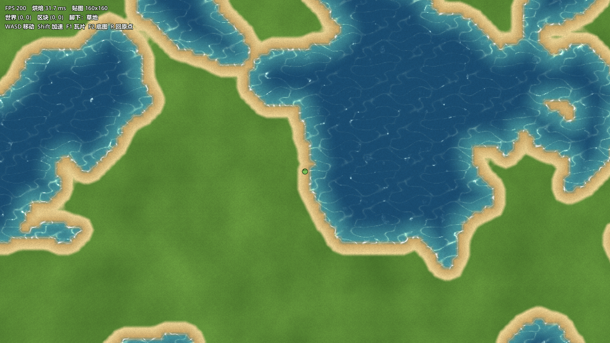
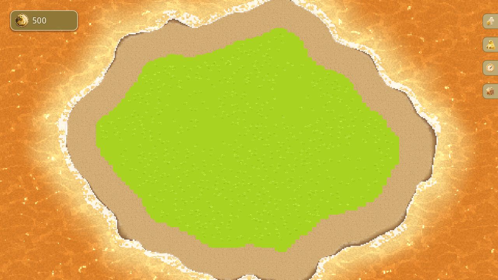
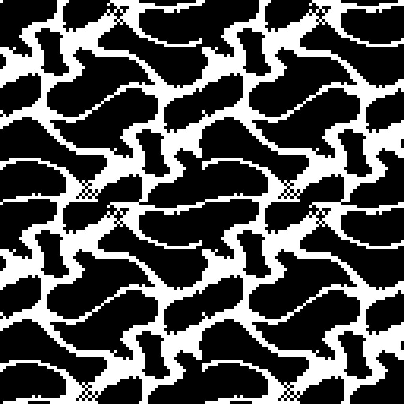
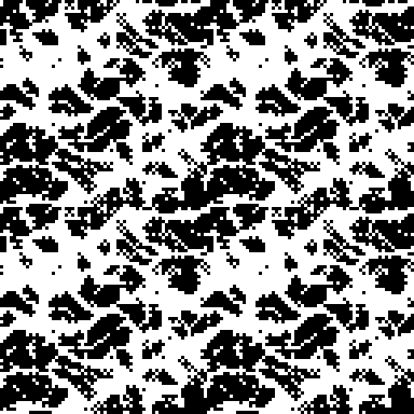
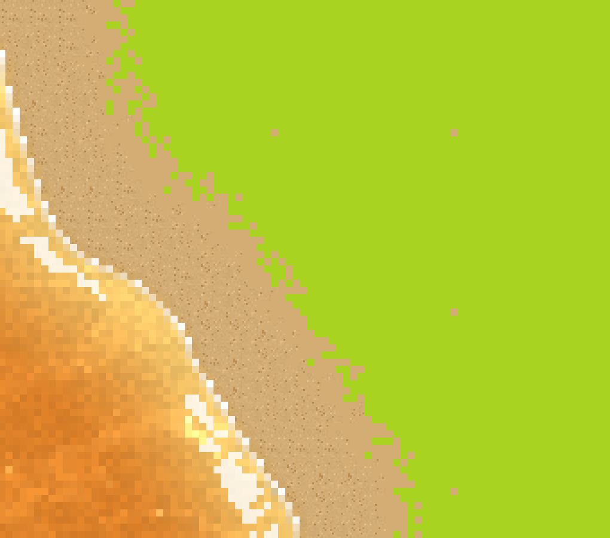

# 水体系统（原型）

> 按「柏林噪声 → 高度数组 → 瓦片分类 → 烘一张小图 → 世界坐标采样 → 四层水体效果」这条链路做出来的可跑原型。
> 场景：`res://scenes/proto/water_proto.tscn`



<sub>左上的 HUD 是调试信息；F1 可以看到瓦片分类（[那张图](images/water_proto_tiles.png)）。</sub>

## 已接入正式关卡（Framland）



`scenes/farm/level.tscn` 里现在多了三个节点，岛是**运行时生成**的：

| 节点 | 作用 |
| --- | --- |
| `Layers/GrassLayer` | 你原本的草地层，运行时被**重新铺成岛屿形状**（还是用你那张 `grass.png` 的 (1,1) 图块） |
| `Layers/BeachLayer` | 新加的沙滩层，用 `assets/tilesets/sand_island.png` |
| `SeaCanvas` | 海水，挂 `water_world.gdshader`，`ground_mix = 0`（只画水，地面交给瓦片） |
| `IslandTerrain` | 生成岛形、烘焙高度图、铺瓦片、调 shader 参数 |

**改了一处你的原设置**：`GrassLayer` 的 `scale` 从 `(0.945, 0.854)` 改成了 `(1, 1)`。
原来草地被非等比缩放过，而 `FramlandLayer` 是 1:1，两层本来就对不齐；而且非等比缩放下「一格 = 16 世界像素」不成立，高度图、距离场、像素化网格全都会偏。现在两层都是 1:1。

**图层顺序**（踩过的坑，改的时候别动）：

```
GrassLayer  -20   草地
BeachLayer  -19   沙滩
SeaCanvas   -10   海水（alpha 只在海面 > 0）
Framland/角色  0   农场、角色、装饰
```

草地必须在海水**下面**。之前草地留在默认 z=0，压在水层上面，结果水线的柔边和抖动过渡全被草地瓦片盖住，岸线永远是一条 16px 硬台阶——看着像"没写对"，其实是图层画反了。

### 怎么改（编辑器里）

**草地是你的，脚本不碰它。** `IslandTerrain` 现在只做三件事：

1. 读 `GrassLayer` 有哪些格子 → 有格子的算陆地、没格子算水；
2. 在最底层（`z_index = -30`）铺满沙滩；
3. 按上面这个水陆关系烘焙高度图，水面从「草地边缘往外 `beach_tiles` 格」开始。

所以**岛的轮廓 = 你草地画出来的轮廓**。图层顺序固定成：

```
BeachLayer  -30   沙滩（铺满，最底层）
SeaCanvas   -10   海水
GrassLayer    0   你的草地（脚本不碰）
Framland      0   农田
```

海水在草地**下面**，所以就算水面算歪了也永远不会盖住你的草。

编辑器里默认**什么都不做**（之前自动生成把你手工摆的草地写进 .tscn 覆盖掉了）。
要重算就拨 `IslandTerrain` 的 `regenerate_now`——它只改沙滩层和高度图，不动草地。

| 想改什么 | 在哪改 |
| --- | --- |
| 岛（水线）形状 | 直接改 `GrassLayer` 的格子 |
| 沙滩宽度 | `IslandTerrain.beach_tiles`，并同步材质的 `shore_offset`（**= -beach_tiles**） |
| 浅水→深水的跨度 | `sea_depth_tiles`，同步材质的 `shallow_width` |
| 海面颜色 | `SeaCanvas` → Material → `col_water_shallow` / `col_water_deep` |
| 白描边 | `rim_width` / `col_rim` |
| 浪花 | `foam_opacity` / `foam_scale` / `foam_pixel` |
| 像素颗粒度 | `edge_pixel` / `pixel_size` / `foam_pixel` |

> `shore_offset` 是**负的**：距离场在水里是正的，要加水线往外推就得减。
> 写正数会让水缩进草地里面（被草地盖住，看不见水）。


### 岸线细节怎么处理的

1. **水线用距离场 + 噪声**，不用瓦片蒙版 —— 所以岸线是平滑的，而且会随时间在沙滩上来回走（起伏动画）。
2. **`shore_offset = 0.75`** 把水线往岸上压一点，正好盖住沙滩最外圈的瓦片台阶。
3. **草地↔沙滩用抖动过渡**：交界处撒 2px 的沙粒，把 16px 的硬台阶变成像素风常见的 dither。
4. **浪花 = 模糊后的主贴图 × 缩小版焦散**（像素化版）：
   - 主贴图（水体蒙版）模糊，但**在更粗的像素网格上采**（`foam_pixel`，默认 4px），块状而非平滑渐变
   - 在模糊后的「白色区域」里铺缩小版浪花贴图，得到一簇簇白
   - 每个 `foam_cell`（默认 64px）随机换偏移 + 一半格子镜像 → 变体随机，不看出平铺
   - 最后 `step()` 成硬边：像素风的浪花是实心白块，不是半透明的一层雾
   - ⚠️ 深水区的模糊值同样是白的，必须再乘一道「离岸 2~3 格」的限制，否则浪花会铺满整片海
5. **岸边浅色环**（不是硬描边）：`rim = (1 - smoothstep(0, rim_width, d)) * step(0, d)`。
   外边界是硬的（像素台阶），内侧往水里渐隐——和水线共用同一个距离场，所以严丝合缝。
   `rim_width` 0.18 格 ≈ 3px，`col_rim` 是比水色亮一档的颜色。
6. **海岸线本身也像素化**：距离场在 `edge_pixel`（默认 1px）的网格上取，再 `step` 成硬边。
   不 `step` 的话边缘是一圈抗锯齿的糊边，和 16px 的瓦片美术根本不搭。
7. **距离场要做两遍平滑**（`_smooth_dist`）。倒角距离变换出来的等值线是八方向折线，
   直接拿来画海线会是一段直边接一段直边、拐角特别硬。磨过之后等值线才是圆滑的曲线。


 

两张都是 **64×64 的硬边像素图**（有序抖动、无抗锯齿），用 `filter_nearest` 放大采样。
之前的焦散是 256² 的平滑灰度渐变，放大就糊成一片——这种做法在像素风里根本不能用。


**海面渐变方向**：近岸浅水 = 浅黄（亮），越往外越深 = 橙黄。
实现上就是 `water_col = mix(col_water_shallow, col_water_deep, depth_t)`，`depth_t` 用「离岸几格」算。
想反过来，交换脚本里 `col_water_shallow` / `col_water_deep` 两个颜色即可。

> 注意：颜色是在 `island_terrain.gd` 的 `_tune_sea_material()` 里**显式设置**的，不是靠 shader 默认值。
> 之前只改 shader 默认值时，运行中的材质用的还是旧值，改了半天没反应。




### 已知限制

- 岛是运行时生成的，**直接打开 `level.tscn` 看到的是旧的那块矩形草地**；必须从 `farm.tscn` 跑（岛要拿场景里的 `Camera2D` 来定位，`IslandTerrain.player_path` 指的就是它）。
- 海面现在还偏"暖黄沙漠"的观感——焦散贴图在暖色上读起来像沙纹。正式美术阶段换一张更细、更"网状"的焦散图会好很多。
- `anim_diff` 那张热力图：[images/water_farm_anim_diff.png](images/water_farm_anim_diff.png)，陆地区域全黑（完全静止），只有水线和焦散在动。


## 怎么跑

用 Godot 4.7 打开工程，直接 F6 运行 `scenes/proto/water_proto.tscn`。

| 操作 | 作用 |
| --- | --- |
| WASD / Shift | 走路 / 加速 |
| F1 | 显示瓦片分类（16px 占位图集），验证「高度 → 草地/沙滩/水体」这条链路 |
| F2 | 关掉 shader 里的地面配色，只看水体叠加层（正式接入时的形态） |
| R | 回原点 |

命令行截图（开发用，会自动退出）：

```bash
godot --path milky-frog-stead res://scenes/proto/water_proto.tscn --quit-after 1500 \
      -- --shot out.png [jump_x jump_y] [--anim] [--tiles]
```

- 默认：截一张 → 平移 (38,22) 再截一张，用来验证「相机移动时水纹不跟着滑」
- `--anim`：开着动画截两张，验证「只有水在动」
- `--tiles`：截图时把瓦片层打开、关掉底图

## 数据流

```
FastNoiseLite（世界坐标采样）
        │
        ├─→ height[]（每格一个值，按区块缓存）
        │        │
        │        ├─→ 阈值分类 → 草地/沙滩/水体（硬阈值，给玩法/碰撞用）
        │        └─→ 倒角距离变换（水线内外各一张）
        │
        └─→ 打包成 160×160 的 RGBA8 小图（1 texel = 1 格）
                 R = 水深 0..1     G = 到水线的有符号距离（0.5 = 水线）
                 B = 陆地高度      A = 水体蒙版 0/1
                        │
                        │  只在跨区块时重烤一次，矩形以玩家区块为中心、
                        │  外扩 8 格余量（防止采到贴图边缘的 clamp）
                        ▼
        WaterCanvas（覆盖视口的一块四边形，挂 water_world.gdshader）
          world_pos = MODEL_MATRIX * VERTEX      ← 不含相机变换，所以世界锚定
          uv = (world_pos - rect_origin) / rect_size
          四层：地面配色 → 焦散（流动噪声扰动）→ 高光（双向噪声相减）→ 浪花（SDF 带）
```

## 文件

| 文件 | 作用 |
| --- | --- |
| `scripts/world/terrain_field.gd` | 高度生成、区块缓存、距离场、烘焙、跨区块更新、玩法查询 |
| `scripts/world/water_canvas.gd` | 跟着相机走的四边形，把焦散贴图塞进材质 |
| `shaders/water_world.gdshader` | 全部水体效果，五段式，参数全在 uniform 里 |
| `scripts/world/proto_player.gd` | 走路小方块 |
| `scripts/world/proto_hud.gd` | HUD + 调试按键 + 截图 |
| `assets/textures/water/caustics.png` | 占位焦散（256²，无缝平铺，Python 生成） |
| `assets/tilesets/terrain_placeholder.png` | 占位地形图集（4×3 个 16px 瓦片） |
| `tools/gen_assets.py` | 生成上面两张图 |
| `tools/height_hist.gd` | 量高度分布，用来定阈值（这个很有用，见下） |

## 关键参数

| 参数 | 位置 | 说明 |
| --- | --- | --- |
| `h_water` | TerrainField | 水 / 沙 分界高度，决定水面占比（默认 0.46 ≈ 31%） |
| `beach_width` | shader | 沙滩宽度（格），整条岸线最直观的旋钮 |
| `shallow_width` | shader | 浅水带宽度（格），从水线往里多少格算深水 |
| `caustics_size` | shader | 一张焦散贴图铺多少世界像素 |
| `flow_strength` / `flow_speed` | shader | 流动噪声的扰动强度 / 速度（前者就是"避免贴图被拉扯"要调的量） |
| `foam_width` / `foam_bleed` | shader | 浪花带在水里的宽度 / 往沙滩上溢出多少 |
| `pixel_size` | shader | 世界坐标像素化网格（默认 2，必须是美术像素的整数倍） |
| `ground_mix` | shader | 1 = 画整块地面；0 = 只画水，叠在手绘瓦片上 |
| `anim_speed` | shader | 0 可以冻住水面，方便截图对比 |

高度阈值不要凭感觉拍：先跑 `tools/height_hist.gd` 看分位数。Perlin FBM 的实际分布很窄（p1~p99 只有 ±0.37），按 0~1 均匀分布去猜阈值一定会翻车。

## 已验证

| 项 | 结果 |
| --- | --- |
| 世界锚定 | 平移 (38,22) 后两张图逐像素平均差 **1.05/255**（不平移是 13.2） |
| 动画只在水里 | 差值热力图里陆地全黑，只有焦散线在动 |
| 跨区块重烤 | 跳 900px 后新区域无接缝，烘焙 23.7ms（首次 31ms） |
| 帧率 | 200 FPS @ 1920×1080（RTX 5060 Ti，D3D12） |

## 已知代价 / 下一步

1. **跨区块会掉 1~2 帧**（烘焙 24~31ms）。真要上线的话：把烘焙丢进 `Thread`（纯 Packed 数组运算，不碰场景树），或者只重算新进来的 16 列、其余用内存平移。
2. **1 texel = 1 格 → 岸线有 16px 台阶**。这是刻意的（和瓦片网格对齐），嫌糙就把 `TEXELS_PER_TILE` 提到 2，代价是烘焙 4 倍。
3. **焦散贴图是 Python 生成的占位**。正式素材画一张 128 或 256 的无缝图就行，`caustics.png` 的 alpha 通道存亮度，shader 只用 alpha。
4. **地面还是 shader 纯色**。接入正式美术时把 `ground_mix` 设 0，让手绘瓦片当底，水体只叠效果。

## 接进正式关卡

1. 把 `WaterCanvas` + `TerrainField` 两个节点连同 `Ground`（TileMapLayer）搬进 `scenes/farm/level.tscn`。
2. 把 `TerrainField._setup_tileset()` 里的占位图集换成正式 TileSet。
3. shader 的 `ground_mix` 设 0；`beach_width`/`shallow_width` 按美术尺寸调。
4. 玩家用现有的 `character`，把 `TerrainField.player_path` 指过去；`material_at_world()` 可以直接拿来做碰撞/种植判定。

## 踩过的三个坑（都写进代码注释了）

1. **距离场不能用「高度差 ÷ 高度梯度」近似**。在平缓的高地上梯度趋近 0，距离会爆到几十格，于是在远离水的草地上拉出一条条横的沙滩带。必须做真正的倒角距离变换。
2. **烘焙矩形要以「区块 − 视距」为起点**。写成以区块索引起点的话，整张图会整体偏移 `view_chunks × 区块尺寸`，屏幕一侧会一直采样贴图被 clamp 的边缘——表现为一片"冻住的"纯色，看起来还挺像草地，很容易蒙混过去。
3. **`position` 只在跨区块时跳**。如果每帧按相机位置重烤，整片水会跟着镜头一起滑；格子里必须存世界量，不是相机相对量。
