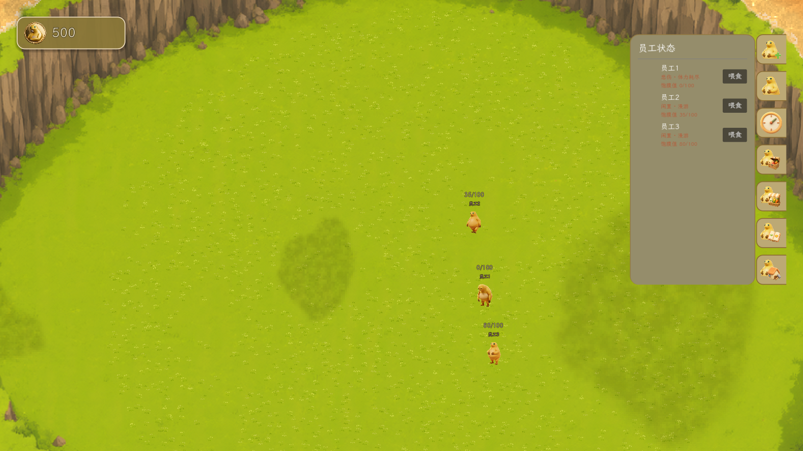
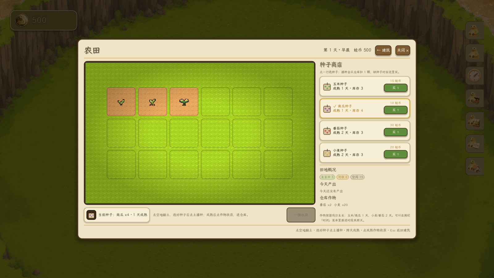
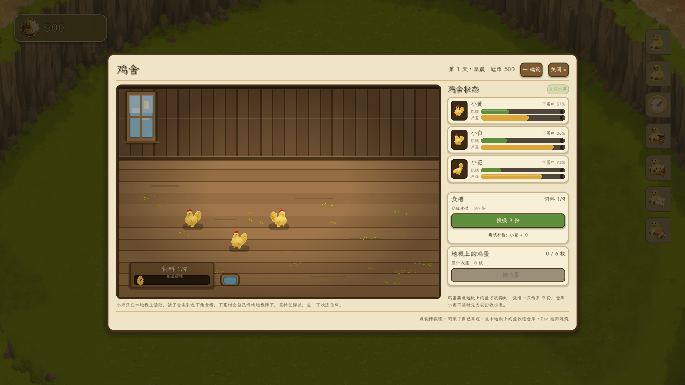

# 界面与体验修复（2026-11-23）

本轮针对试玩反馈修的 5 个问题，全部在 `feature/buildings` 上。

## 1. 鸡卡在墙边 / 极度饥饿

原因：漫游目标先随机、再“离得太近就加偏移”，偏移后可能落在活动区外；
鸡会一直朝墙外走，又被 `_apply_chicken_position` 夹在墙边，距离目标始终不为 0，于是永久卡住。
食槽用餐点也没有夹 X 轴，边缘的鸡可能走到墙边。

修法（`scripts/ui/building_coop_window.gd`）：

- `_pick_wander_target` 最后把目标 `clamp` 回活动区；
- `_trough_eat_point` 的 X/Y 都夹在活动区内；
- 新增 1.2 秒“几乎没移动”的卡住检测：重新选点、往活动区中心轻推；
  如果卡住时正在去下蛋，则安全取消这次下蛋，下次重新走。

## 2. 鸡舍只在观测时推进

`autoload/coop_state.gd` 不再按真实秒数计时，而是统一读 `DayNightCycle.day/hour`：

- 饥饿：+1.5 / **游戏小时**；产蛋间隔：6~10 **游戏小时**；
- 侧栏「时间」菜单跳时段、跨天，或直接补算游戏小时，都会推进鸡舍；
- 关窗时饥饿/产蛋计时继续走，饿了先吃食槽，食槽空会从仓库自动补一份（不播走路动画）；
- **蛋仍然只由界面驱动**：打开鸡舍后，鸡走到木地板落蛋点、蹲下，界面才调 `lay_egg()`，
  所以不会出现“没人看着就凭空多蛋”。
- 切场景/读档后第一次观察时钟只做静默对齐，不会把关游戏的时间误算成进度。

## 3. 植物旁的小黑点

不是 UI 画的点，是两张作物素材里的孤立像素：

- `assets/plants/wheat.png` 第 0 帧：3 个孤立深色像素；
- `assets/plants/tomato.png` 第 1 帧：8 个孤立深色像素。

用连通域筛选把这两个小连通块清成透明，其他像素未动。

## 4. 员工状态页只显示一半 / 内部滚动

- `scenes/ui/menus/menu_npc_status.tscn`：滚动区从固定 `240px` 改为 `size_flags_vertical = EXPAND_FILL`，
  删除底部占位 Spacer；抽屉有多高，列表就用多高，只有员工多到装不下时才滚动；
- `scripts/ui/menu_npc_status.gd`：「喂食」按钮从 info 列底部移到行右侧，缩成 58×34，
  名单行更紧凑，不会再出现按钮被拉伸/挤到下一屏。

## 5. 字体

原字体：SystemFont 幼圆 / 华文琥珀（依赖系统字体，观感偏旧）。

现字体：[LXGW WenKai Lite（霞鹜文楷 Lite）](https://github.com/lxgw/LxgwWenKai-Lite) v1.530：

- 正文：`assets/fonts/LXGWWenKaiLite-Regular.ttf`
- 标题/按钮：`assets/fonts/LXGWWenKaiLite-Medium.ttf`
- 主题通过 `FontVariation` 引用，见 `assets/themes/game_font.tres`、`title_font.tres`；
- 许可证：SIL Open Font License 1.1，随字体放在
  `assets/fonts/licenses/lxgw-wenkai-lite/OFL.txt`。

选择原因：文楷是手写感、圆润、可读性好的中文字体，和木框纸面板 / 像素农场的温暖风格比幼圆更搭；
Lite 版本覆盖常用简体中文，文件也不至于太大。

## 验证

- `buildings_smoke`：70 项 PASS（新增：关窗后时间仍走并自动吃食、漫游目标不越界、食槽点在活动区）
- `shop_smoke`：38 项 PASS
- `cooking_smoke`：38 项 PASS
- `drag_care_smoke`：57 项 PASS（同步 master 的“新员工饱腹默认 0”：测试里先喂饱再测大笑）
- `time_flow_smoke`：10 项 PASS（时间菜单跳时段/补算游戏小时推进鸡舍，但不会凭空多蛋；打开鸡舍后鸡才去落蛋点）

