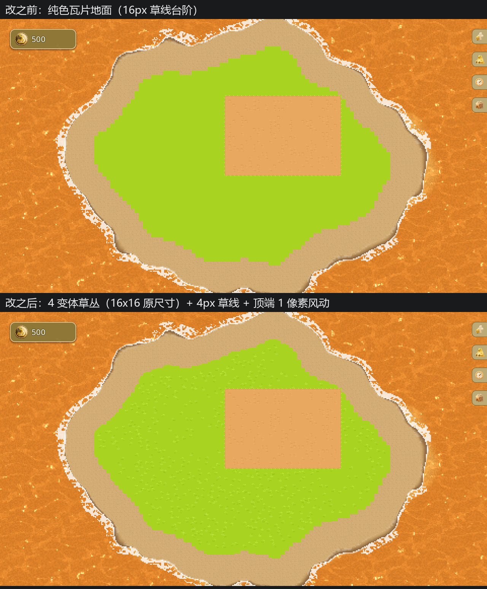
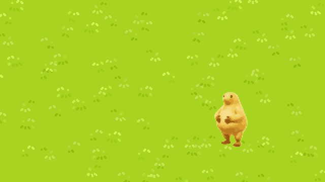
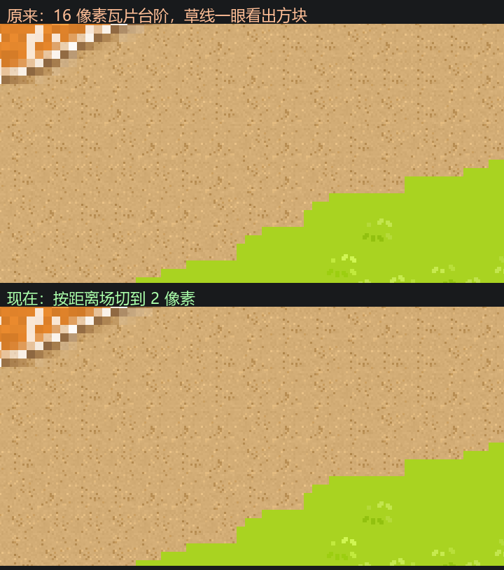

# 2D 像素草地（把 3D 那套思路改写成 2D）

> 一句话：**3D 版本里有一半的工作量在「让平面片看起来立着」——billboard、法线对齐、卡通光照；
> 2D 俯视视角把这半件事直接送给了你，代价是换来三件新的苦差事：像素栅格、绘制顺序、逐实例数据通道。**
> 这篇文档就是那份「换掉什么 / 留下什么」的清单，以及照着它写出来、已经接进主场景的代码。

配套文件：

| 文件 | 作用 |
| --- | --- |
| `shaders/grass_ground_2d.gdshader` | **地面层**：色块（可选）+ 2 像素草线切边（挂在草地 TileMapLayer 的 material 上） |
| `shaders/grass_tuft_2d.gdshader` | **草丛层**：4 变体取样、顶端 1 像素风动、色块（可选）、踩踏 |
| `scripts/world/grass_field_2d.gd` | 铺草：分块 MultiMesh、疏密噪声、遮罩/排除层、推挤源 |
| `scripts/world/proto_grass.gd` + `scenes/proto/grass_2d_proto.tscn` | 单独验证场景（代码搭的，方便反复改参数） |
| `scenes/proto/shot_farm.tscn` / `shot_farm_before.tscn` | 主场景截图 / 关掉草地的 A/B 对照 |
| `assets/sprites/decorations/grass_tuft.png` | 草丛精灵：64x16 = **4 帧 16x16** |
| `assets/textures/noise/grass_noise.png` | 疏密/色块用的无缝噪声（`tools/gen_grass_noise.py` 生成） |



---

## 一、结论先说

在你的 3D 流程里，下面这些步骤在 2D **直接消失**，不用找对应物：

- **billboard（面向摄像机）**：俯视镜头本来就正对着精灵。
- **让四边形法线跟随地形**：2D 没有法线，也没有 Z。
- **卡通着色器里的 NdotL / 光照计算**：像素画的明暗是美术画进图里的，不是算出来的。

而下面这些**必须换做法**，照搬一定出错：

| 3D 里的做法 | 2D 里为什么不行 | 2D 的做法 |
| --- | --- | --- |
| 实例 ID / `INSTANCE_CUSTOM` 取随机种子 | canvas_item 着色器**没有** `INSTANCE_CUSTOM`（实测报错） | ① `MultiMesh.use_colors` 的实例颜色当数据通道；② 世界坐标 hash |
| 关掉阴影投射换性能 | 2D 没有阴影贴图，但有**绘制顺序**问题 | `z_index` 分层；要穿插时用区块 y-sort |
| 顶点着色器改「高度」/ 连续缩放 | 2D 没有高度；连续缩放会毁掉像素栅格 | 草丛**保持原尺寸 16x16**，变体靠换帧不靠缩放 |
| 片元里给草染色（乘 albedo） | 像素画会被乘出**调色板外**的脏色 | 可选：**换调色板**（把三档色阶映射到地面已有的绿） |
| 绕「垂直于风向的世界轴」旋转 | 俯视平面上没有那根轴，转起来像贴纸打转 | 只动顶端、只动**整数像素**（剪切），幅度 1~2px |
| 视锥剔除 / 深度缓冲解决遮挡 | 没有深度缓冲 | 按区块分装，靠 `z_index` / y-sort |
| 瓦片边缘 16px 台阶 | 瓦片是 16px 的，草线会是一排大台阶 | 拿距离场在**着色器里切到 2 像素** |

**完整留下来的**（思路可以原样搬）：多网格实例铺满地面、世界空间噪声、两路「偏开一个发散角」的风向各采一次噪声相乘、无理数比例错开、时间量化成低帧率 + 逐实例相位。

---

## 二、这套 2D 版怎么工作

### 0. 三层结构

```
地面瓦片层  ← grass_ground_2d.gdshader    2px 草线切边（+ 可选色块）
草丛层      ← grass_tuft_2d.gdshader      4 变体取样 + 顶端像素风动 + 踩踏
疏密        ← grass_field_2d.gd           同一张噪声决定"这格长不长草"
```

### 1. 草丛：4 个变体，随机选

精灵是 64x16 = **4 帧 16x16**。每个实例随机取一帧 + 随机水平镜像 = 8 种样子：

```gdscript
# 变体编码：shader 里 vv = 变体 * frame_count
var variant := (float(frame) + (0.25 if flip < 0.5 else 0.75)) / float(frames)
```

```glsl
float vv = clamp(v_var, 0.0, 0.9999) * frame_count;
float col = floor(vv);
float flip = mod(floor(fract(vv) * 2.0), 2.0);
float u = mix(v_uv.x, 1.0 - v_uv.x, flip);
vec2 uv = vec2((u + col) / frame_count, v_uv.y);
```

> ★ **这里踩过一个很隐蔽的坑**：`frame_count` 在 GDScript 里是导出量，在着色器里是
> **另一个 uniform**。脚本不主动写进去，它永远是 1 —— 于是整张 64x16 被压进 16x16 的
> 四边形（横向压扁 4 倍），四帧也全部失效。表现就是"草丛被拉伸、四个变体看不出区别"。
> 现在 `rebuild()` 里会显式写一次：`tuft_material.set_shader_parameter("frame_count", …)`。

### 2. 风：只动顶端、只动整数像素

草丛**不做整体平移**（那样像整块贴纸在飘）。改成：

```glsl
// 逐实例三角波：周期约 0.8 秒、幅度 1 像素，相位各自不同
float base = abs(fract(t * 2.5 + COLOR.g * 3.1) * 2.0 - 1.0);
float amp  = clamp(max(gust * 1.2, base * 0.8), 0.0, 1.6);
float h    = clamp(1.0 - UV.y, 0.0, 1.0);          // 0 = 根部, 1 = 顶部
vec2 offset = d * (gust * wind_slide + amp * wind_shear * pow(h, shear_pow));
if (pixel_snap > 0.5) { offset = floor(offset + 0.5); }   // 取整到像素
```

- `wind_slide = 0`：不许整体晃。
- `wind_shear = 1.2` + `subdivide = 4`：竖直分 4 段，**每段单独取整**，所以只有顶上 1~2 段跳 1 像素。
- 阵风（两路偏开的风向噪声相乘）仍然在，负责让成片的草同时动一下。



### 3. 地面色块（可选，默认关）

3D 的「采样噪声 → 和阈值比较 → 选一种草地颜色」，在 2D 里变成**换调色板**而不是乘颜色：

```glsl
vec3 lo  = patch < 0.34 ? pal_0_lo : (patch < 0.68 ? pal_1_lo : pal_2_lo);
...
float d_lo = abs(luma - dot(pal_1_lo, LUMA));   // 按亮度归到最近的一档
```

> 默认 **`patch_strength = 0`（关）**：整片草地用瓦片原色 + 精灵原色，看起来更干净。
> 想打开就把它设成 1（地面层和草丛层各有一个，要一起改）。
> 中间值（0.3~0.6）是"淡淡的日照/阴影差"，也可以试。

### 4. 草线 2 像素细分

瓦片是 16px，靠瓦片拼出来的草线必然是一排 16px 大台阶。做法是让**着色器按距离场切**：

```glsl
// 2 像素网格上取距离场（1 texel = 1 格瓦片，双线性插值出亚格精度）
vec2 eq = floor(v_world / edge_pixel) * edge_pixel;              // edge_pixel = 2
float sd = (texture(mask_tex, (eq - rect_origin) / rect_size).g - 0.5) * 2.0 * sdf_range;
if (-sd <= grass_edge + edge_inset) { discard; }                 // 落在沙滩侧 → 丢掉，露出沙滩
```

两个配套细节：

1. `mask_tex` 就是水体已经在用的那张距离场，`IslandTerrain` 在烘完地形后顺手传给草地层材质
   （`_sync_grass_edge_mask()`），所以不额外烘一张图。
2. **沙滩要多铺 1.5 格**（`beach_overlap_tiles`）。切掉的地方必须已经铺了沙滩瓦片，
   否则切出来是空气；多铺的这几格平时被草地盖住，看不见。



### 5. 交互：踩开

```glsl
vec2 dp = anchor - pusher.xy;
float f = 1.0 - dist / radius;
offset += normalize(dp) * strength * f * f * h;   // 根不动，离得越近倒得越狠
```

`pushers[4]` 每帧由 GDScript 写入（`Npc` 自动进 `grass_pusher` 分组，最多 4 个，离镜头近的优先）；
`grass_field_2d.gd` 里有一层 `heat`：
**只有推挤源在动才踩开**，停下来 0.55 秒草丛自己弹回来。

---

## 三、已经接进主场景

`farm.tscn` 里（打开游戏就能看到）：

| 节点 | 配置 |
| --- | --- |
| `Level/Layers/GrassLayer` | `material` = 地面层材质（2px 草线切边 + 色块关） |
| `GrassField`（`farm.tscn` 直下） | 草丛层，`z_index = -5`，`mask_mode = terrain` → `../Level/IslandTerrain`，`avoid_paths` = 农田层 + 沙滩层 |

- **等两帧再生成**（`build_delay_frames = 2`）：沙滩/农田是运行时才铺的瓦片，排除层要等它铺完。
- **不会长在农田/沙滩上**：`avoid_paths` 里那两层有瓦片的格子直接跳过。
- **推挤源**：`Npc._ready()` 里已经自动 `add_to_group("grass_pusher")`，员工 NPC 开箱即踩；
  玩家节点加一句 `add_to_group("grass_pusher")` 就行。半径 38、力度 5，最多同时算 4 个（离镜头近的优先）。

```bash
cd milky-frog-stead
godot --path . res://scenes/proto/grass_2d_proto.tscn                 # 独立验证场景
godot --path . res://scenes/proto/shot_farm.tscn -- --shot D:/farm.png
godot --path . res://scenes/proto/shot_farm_before.tscn -- --shot D:/before.png
```

验证场景的临时旋钮：`--zoom= --cell= --density= --jitter= --decor= --scale= --subdivide= --patch=1 --push=x,y --seq=N`。

---

## 四、关键参数速查

### 铺草（`GrassField2D`）

| 参数 | 默认 | 说明 |
| --- | --- | --- |
| `area` | 全图矩形 | 铺草范围 |
| `cell_size` | 24 | 一棵草平均占多大格；决定"像纹理"还是"像点缀" |
| `density` | 0.85 | 铺出比例，还会乘上噪声疏密 |
| `jitter` | 0.5 | 位置抖动 |
| `decor_chance` | 0.03 | 同一格多长一株的概率 |
| `big_chance` | **0** | 放大 2 倍的变体，默认关（放大后和周围对不上） |
| `frame_count` | 4 | 精灵横向帧数（脚本会把它写进 shader uniform） |
| `subdivide` | 4 | 竖直细分，风动的分段粒度；给 0 就退化成整块斜 |
| `avoid_paths` | 农田/沙滩 | 这些层有瓦片的格子不长草 |
| `build_delay_frames` | 2 | 等几帧再生成（等地形铺完瓦片） |

### 地面层（`grass_ground_2d.gdshader`）

| 参数 | 默认 | 说明 |
| --- | --- | --- |
| `edge_pixel` | 2 | 草线细分粒度（像素） |
| `grass_edge` | 4.0 | 到水线几格以内算沙滩，要等于 `IslandTerrain.beach_tiles` |
| `edge_inset` | 0 | 正数 = 草线往岸上推 |
| `patch_strength` | 0（场景里） | 色块强度；0 = 纯色地面 |
| `patch_scale` / `patch_contrast` | 900 / 1.15 | 色块尺度与硬边程度 |

### 草丛层（`grass_tuft_2d.gdshader`）

| 参数 | 默认 | 说明 |
| --- | --- | --- |
| `wind_dir` / `wind_speed` | (1,0.35) / 26 | 风向、阵风推进速度（世界像素/秒） |
| `wind_slide` / `wind_shear` | **0** / 1.2 | 整体平移（关）/ 顶端剪切幅度（像素） |
| `gust_spread` / `gust_gain` / `gust_bias` | 42 / 2.8 / -0.22 | 发散角、放大、静止草比例 |
| `anim_fps` | 9 | 时间步进；0 = 连续 |
| `pixel_snap` | 1 | 位移取整到像素 |
| `patch_strength` | 0（场景里） | 草丛换色调色板的强度 |

---

## 五、已验证

- 主场景 1920x1080 真机渲染：**731 个草丛 / 25 个区块 / 生成 9.8 ms**；
  验证场景满屏 **3398 个 / 77 个区块 / 20 ms**（RTX 5060 Ti，D3D12，Forward+）。
- 草丛是 16x16 原尺寸、四帧随机（不再横向压扁）。
- 草线台阶 2px（见上图对照）。
- 风：两次采样之间约 5~8 千像素变化，全部集中在草丛顶部 1~2 行，不是整块位移。

## 六、已知取舍 / 下一步

1. **重复感**：4 帧 + 镜像 = 8 种。再想细就画更多帧。
2. **前后遮挡**：草丛整层在角色下面（`z_index=-5`）。要做"走进高草被草叶挡脚"，
   得让区块按角色 Y 排序，代价是区块边缘的排序误差。
3. **遮罩/排除层是一次性的**：`rebuild()` 只在启动时跑一次。地形会变的话要给区块做局部重建。
4. **性能余量**：整张图一次铺完。地图再大就按相机区块流式增删。

---

## 七、修掉的水体附带问题：草线在抖

`water_world.gdshader` 第 5.5 段原来有一条「草地↔沙滩的抖动过渡」，它的中心挂在
`edge_shore` 上，而 `edge_shore` 每帧被潮汐/起伏/呼吸推着走，2px 的沙粒跟着反复重排 ——
看起来就是像素在沿草线抖。现在用 `tile_edge_dither`（默认 **0**）关掉了，水线本身的
泡沫、潮汐、湿沙、焦散一行没动。

同一段里还有第二个坑：`step(hash, 0)` 在 `hash` 恰好为 0 的格子上会返回 1，于是草地上
零星冒出 4x4 的沙色方块（就是"场景里少了一个像素点"）。现在 `band == 0` 时直接给 0。

---

## 八、踩过的坑（都写进代码注释了）

1. **`INSTANCE_CUSTOM` 在 canvas_item 里不存在** → 改用实例颜色 + 世界坐标 hash。
2. **`QuadMesh` 没有 `subdivide_height`**，4.7 里竖直方向叫 `subdivide_depth`。
3. **色块用乘法染色会脏** → 换调色板。
4. **TileMapLayer 的 `COLOR` 不是白色**：`texture(TEXTURE, UV) * COLOR` 会把颜色平方，
   地面塌成一片死色。地面着色器里**不要乘 COLOR**。
5. **`frame_count` 是着色器 uniform，不是那个导出量**：不写进去就永远 1，
   整张精灵被压进一个四边形（拉伸 + 变体失效）。脚本必须在 `rebuild()` 里写一次。
6. **色阶分档别写死亮度阈值** → 按"离参考调色板哪一档最近"判。
